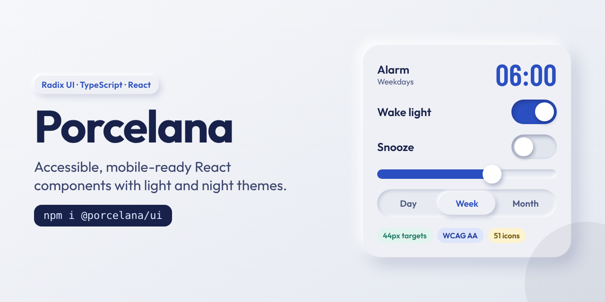
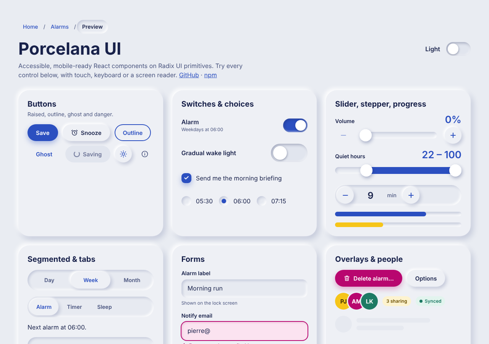

<div align="center">



# Porcelana

**Accessible, mobile-ready React components on Radix UI primitives, in TypeScript, with light and night themes.**

[](https://github.com/pierrejochem/porcelana/actions/workflows/ci.yml)
[](https://www.npmjs.com/package/@porcelana/ui)
[](https://www.npmjs.com/package/@porcelana/icons)
[](LICENSE)

[**Docs & live gallery**](https://pierrejochem.github.io/porcelana/) · [Getting started](https://pierrejochem.github.io/porcelana/guides/getting-started/) · [Components](#components) · [Accessibility](#accessibility) · [Releasing](#releasing)

</div>

Porcelana is an open-source **React component library** and **design system**: 35+ tactile components on porcelain-white raised and recessed surfaces with cobalt accents. Every control is sized for touch, works with a keyboard and screen reader, and switches to bottom sheets and card lists on phones.

| Package | What it is |
| --- | --- |
| [`@porcelana/ui`](packages/ui) | Components, CSS tokens (`--pl-*`), light and night themes |
| [`@porcelana/icons`](packages/icons) | 51 tree-shakable stroke icons on a 24px grid |



## Quick start

```bash
npm install @porcelana/ui @porcelana/icons
```

```tsx
import "@porcelana/ui/styles.css";
import { ThemeProvider, Switch, Slider, Button, Toaster, toast } from "@porcelana/ui";

export function Settings() {
  return (
    <ThemeProvider theme="system">
      <Switch label="Alarm" description="Weekdays at 06:00" defaultChecked />
      <Slider label="Volume" defaultValue={[62]} showValue showSteppers formatValue={(v) => `${v}%`} />
      <Button onClick={() => toast({ title: "Saved" })}>Save</Button>
      <Toaster />
    </ThemeProvider>
  );
}
```

Works with React 18 and 19, Next.js (ships `"use client"`), Vite and Remix. No Tailwind needed.

## Components

| Group | Components |
| --- | --- |
| Actions | Button, IconButton |
| Inputs | Field, Input, Textarea, Checkbox, Radio Group, Switch, Slider, Number Stepper, Select, Combobox, Date Picker, Calendar, Toggle Group |
| Navigation | Tabs, Breadcrumb, Pagination |
| Overlays | Dialog, Alert Dialog, Popover, Dropdown Menu, Tooltip, InfoTip, Toast |
| Data & display | **Data Table** (sort, search, select, paginate), Card, Badge, Avatar, Progress, Skeleton, Accordion |
| Theming | ThemeProvider, `useTheme`, `useIsMobile`, CSS variables |

Every component has a docs page with a live example, its props (generated from the types), and accessibility and mobile notes, for example [Slider](https://pierrejochem.github.io/porcelana/components/slider/) and [DataTable](https://pierrejochem.github.io/porcelana/components/data-table/).

## Mobile-first

- Every interactive element is at least **44 × 44 px**.
- Under **640 px** wide, dialogs become **bottom sheets**, menus become **action sheets** and the data table becomes **tap-to-select cards**.
- Inputs use a 16 px font so iOS doesn't zoom in on focus. Sliders let vertical swipes scroll the page, and sheets and toasts respect safe areas.

## Accessibility

- WAI-ARIA patterns from Radix: focus trapping, roving focus and typeahead.
- Every component is tested with **jest-axe**, plus keyboard and screen-reader-name tests.
- Text meets **WCAG AA** contrast in both themes, and focus rings meet 3:1.
- Supports `prefers-reduced-motion` and Windows high contrast (`forced-colors`).

## Develop

```bash
pnpm install
pnpm preview        # docs site at http://localhost:5173 (props generated from the TypeScript types)
pnpm test           # Vitest + Testing Library + jest-axe
pnpm verify         # lint, build, typecheck, tests with coverage, package checks
```

Requires Node ≥ 20 and pnpm 10 (`corepack enable`).

## Releasing

Releases are automated with [Changesets](https://github.com/changesets/changesets):

1. In your PR, run `pnpm changeset` and describe the change. CI fails without one if a package changed.
2. Each PR gets **preview builds** from [pkg.pr.new](https://pkg.pr.new).
3. When the PR is merged to `main`, the Release workflow opens a **"Version Packages"** PR.
4. When that PR is merged, the workflow **publishes to npm** through [trusted publishing](https://docs.npmjs.com/trusted-publishers) (OIDC, no stored token), with provenance, and creates GitHub releases. The [gallery](https://pierrejochem.github.io/porcelana/) redeploys on every push to `main`.

## License

MIT © [Pierre Jochem](https://github.com/pierrejochem)
