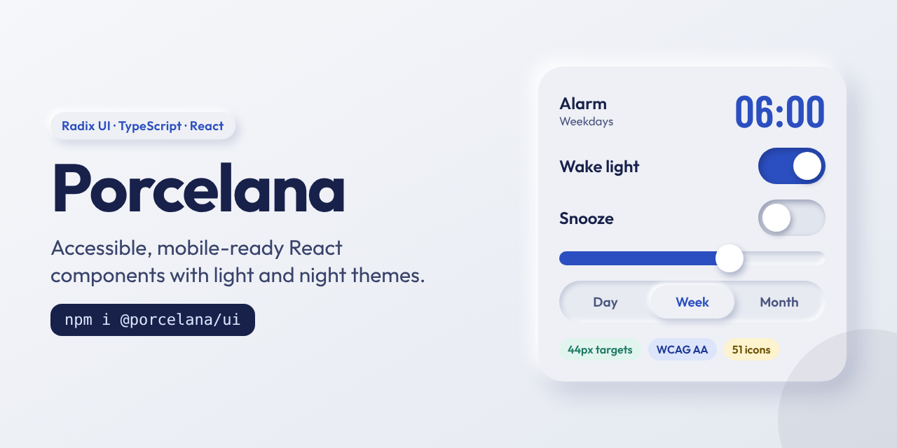

# @porcelana/ui



Accessible, mobile-ready **React component library** on [Radix UI](https://www.radix-ui.com/) primitives. TypeScript, light and night themes, and plain CSS (no Tailwind required).

**[Docs & live gallery](https://pierrejochem.github.io/porcelana/)** · [GitHub](https://github.com/pierrejochem/porcelana) · [Icons](https://www.npmjs.com/package/@porcelana/icons)

```bash
pnpm add @porcelana/ui @porcelana/icons
```

```tsx
import "@porcelana/ui/styles.css";
import { ThemeProvider, Button, Switch, Slider, Toaster, toast } from "@porcelana/ui";

export function App() {
  return (
    <ThemeProvider theme="system">
      <Switch label="Alarm" description="Weekdays at 06:00" defaultChecked />
      <Slider label="Volume" defaultValue={[62]} showValue showSteppers formatValue={(v) => `${v}%`} />
      <Button onClick={() => toast({ title: "Saved" })}>Save</Button>
      <Toaster />
    </ThemeProvider>
  );
}
```

Optional fonts: the design uses **Outfit** and **Barlow Condensed** (numerals); system fonts are the fallback.

## Components

| Group      | Components |
| ---------- | ---------- |
| Actions    | `Button`, `IconButton` |
| Inputs     | `Field`, `Label`, `Input`, `Textarea`, `Checkbox`, `RadioGroup`, `Switch`, `Slider`, `NumberStepper`, `Select`, `Combobox`, `DatePicker`, `Calendar`, `ToggleGroup` |
| Navigation | `Tabs`, `Breadcrumb`, `Pagination` |
| Overlays   | `Dialog`, `AlertDialog`, `Popover`, `DropdownMenu`, `Tooltip`, `InfoTip`, `Toaster` + `toast()` |
| Display    | `Card`, `Badge`, `Avatar`, `AvatarGroup`, `Progress`, `Skeleton`, `Accordion`, `DataTable` |
| Theming    | `ThemeProvider`, `useTheme`, `useIsMobile`, `useMediaQuery` |

## Mobile behaviour

- Every interactive element is at least **44 × 44 px**, including slider thumbs, checkboxes and radio buttons, through invisible hit areas.
- Under **640 px**, `Dialog` and `AlertDialog` turn into bottom sheets, `DropdownMenu` becomes an action sheet and `DataTable` becomes a list of tap-to-select cards with sort chips.
- Inputs use a 16 px font so iOS doesn't zoom in on focus. Tap highlight and the double-tap delay are removed, and sliders let vertical swipes scroll the page.
- Safe areas (`env(safe-area-inset-bottom)`) are respected by sheets and toasts.

## Accessibility

- Radix provides focus management, roving tab index and the WAI-ARIA patterns. Every component is tested with `jest-axe` and keyboard interactions.
- `Field` wires label, description and error (`aria-describedby`, `aria-invalid`, `role="alert"`).
- `Slider` thumbs have names and `aria-valuetext`. `NumberStepper` is a real spinbutton, and `DataTable` uses captions, `aria-sort` and announces live result counts.
- Focus rings are dark blue in light mode and yellow in night mode, and pass 3:1. Text tokens pass 4.5:1 in both themes.
- Honors `prefers-reduced-motion` and Windows high-contrast (`forced-colors`).
- `Tooltip` only appears on hover and focus. Use `InfoTip` (tap to open) for content touch users need.

## Theming

Two surfaces: the default **porcelain** look (soft, pressed shadows on a light grey page) and **white** for apps on pure white pages:

```tsx
<ThemeProvider theme="system" surface="white">…</ThemeProvider>
```

All colours, shadows, radii and spacing are CSS variables (`--pl-*`). Override them on `:root` or `[data-theme="night"]`:

```css
:root { --pl-primary: #0a7d5a; --pl-primary-hover: #086b4d; --pl-primary-text: #0a7d5a; }
```

## Testing your app

Components render in jsdom. Radix needs `ResizeObserver`, `matchMedia` and pointer-capture stubs; copy `src/test/setup.ts` from this repo.
